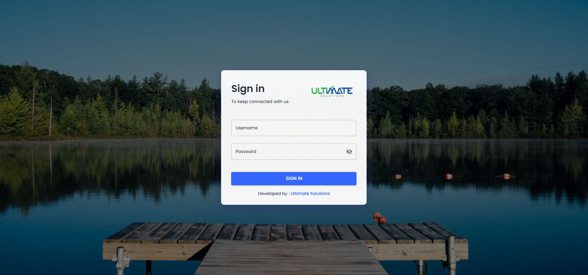

# School Management System

School administration across an ASP.NET Core backend, a React/Vite web portal and an Expo/React Native mobile client. Source modules cover students, teachers, campuses, classes/sections, grades, attendance, diaries, complaints and notifications.

## Components and setup

- **API:** `school-management-Backend/`. Install the matching .NET SDK from its `.csproj`, configure a compatible private SQL database and run `dotnet run --project school-management-Backend/school-management-Backend.csproj`.
- **Admin portal:** `materially-free-react-admin-template-1.0.0/`. Run `npm ci` and `npm start`; configure the API endpoint locally.
- **Mobile:** `SchoolManagementApp/`. Install the package's Expo/native dependencies. Use `npx expo start` for the development server, or the package's Android/iOS scripts with the required native tools. Review the existing `prestart` script before relying on `npm start`.

Use synthetic student/teacher records for demonstrations. Do not publish student profiles, attendance records, credentials or notification keys. Push delivery, permissions, data migrations and role access require a representative test environment.

## Source overview

This diagram is derived from the repository structure; it is not an application screenshot.

## Development and validation

Use an isolated development database and synthetic records. Keep credentials, device sessions, signing keys and operational uploads outside Git. The presence of source code does not establish that every integration or deployment scenario has been tested. See [repository review](docs/REPOSITORY_REVIEW.md) for this audit's scope.

## Ownership and contributions

Existing author, template, asset and dependency attributions remain in place. Follow any existing license files; this documentation update does not grant a new license. For a change, describe the affected workflow, configuration and checks so it can be reviewed without guessing.

## Application screenshot

Captured from this repository’s React administration client running locally. Authentication, school records and mobile workflows were not exercised.
