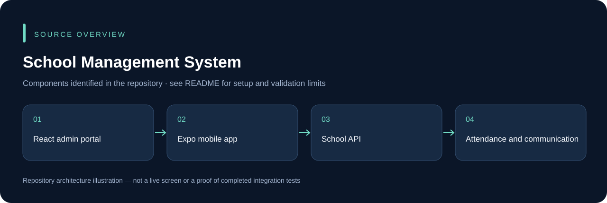

# School Management System

School administration across an ASP.NET Core backend, a React/Vite web portal and an Expo/React Native mobile client. Source modules cover students, teachers, campuses, classes/sections, grades, attendance, diaries, complaints and notifications.

## Components and setup

- **API:** `school-management-Backend/`. Install the matching .NET SDK from its `.csproj`, configure a compatible private SQL database and run `dotnet run --project school-management-Backend/school-management-Backend.csproj`.
- **Admin portal:** `materially-free-react-admin-template-1.0.0/`. Run `npm ci` and `npm start`; configure the API endpoint locally.
- **Mobile:** `SchoolManagementApp/`. Install the package's Expo/native dependencies. Use `npx expo start` for the development server, or the package's Android/iOS scripts with the required native tools. Review the existing `prestart` script before relying on `npm start`.

Use synthetic student/teacher records for demonstrations. Do not publish student profiles, attendance records, credentials or notification keys. Push delivery, permissions, data migrations and role access require a representative test environment.

## Source overview

This diagram is derived from the repository structure; it is not an application screenshot.

## Development and validation

Use an isolated development database and synthetic records. Keep credentials, device sessions, signing keys and operational uploads outside Git. The presence of source code does not establish that every integration or deployment scenario has been tested. See [repository review](docs/REPOSITORY_REVIEW.md) for this audit's scope.

## Ownership and contributions

Existing author, template, asset and dependency attributions remain in place. Follow any existing license files; this documentation update does not grant a new license. For a change, describe the affected workflow, configuration and checks so it can be reviewed without guessing.

## Web and school app galleries

Browse the **[gallery overview](docs/SCREEN_GUIDE.md)**, **[web portal gallery](docs/WEB_GALLERY.md)** and **[school app component gallery](docs/MOBILE_GALLERY.md)**. Each view explains its purpose, expected usage and validation limits.

  

- **13 web views:** actual React/Vite screens with isolated local fixture responses, including the five rule-wizard steps.
- **33 mobile component previews:** actual React Native screen components rendered in a phone-size browser with synthetic state and native adapters. These are **not native Android/iOS screenshots**.
- **Honest scope:** the current web portal focuses on notifications and retains Task Management branding. Templates and Settings are placeholders; the User Management component is commented out. Several mobile components contain built-in mock values. The guides identify these limits.

No real student data, live notification delivery or saved school transaction was used to produce the gallery. Backend authentication/persistence and native device features require separate validation.
