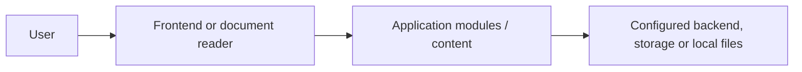

# School Management Mobile App | Expo, React Native, Firebase

Mobile school administration application using Expo/React Native with backend services and Firebase messaging integration for school workflows.

**Explore this repository:** [Architecture](docs/ARCHITECTURE.md) · [Developer runbook](docs/RUNBOOK.md) · [Screenshot evidence guide](docs/SCREENSHOT_GUIDE.md) · [Audit](docs/PORTFOLIO_AUDIT.md)

**Discoverability topics:** `school-management` · `react-native` · `expo` · `education` · `firebase` · `mobile-app`. These are suggested GitHub repository topics, not a claim that the repository settings have been updated.

> **Verification status:** Documentation derived from inspected repository files. Application execution and screenshots have not yet been verified.

## Purpose and features

Expo/React Native app in `SchoolManagementApp/`, backend in `school-management-Backend/`, plus a separate admin template.

## Architecture

This diagram is conceptual, not a claim about a deployed system. Refer to the repository directories above for the actual source.

## Installation and running

Mobile: `cd SchoolManagementApp && npm ci && npm start`. Native Firebase modules may require a development build and backend configuration.

Install required runtimes and dependencies, inspect package manifests, and provide secrets through local ignored configuration. These commands are **not yet runtime-tested**.

## Screenshots and walkthrough

No verified runtime screenshots have been captured. Once the application runs with sanitized demo data, capture each screen into `docs/screenshots/`, document its purpose and workflow, and record the run command and commit. Do not use synthetic screenshots as evidence of running code.

## Security and maintenance

Review committed Firebase config and ensure no private keys, access tokens or personal data are disclosed.

Run dependency checks, verify licenses and inspect configuration before deployment. Do not include real credentials or private data in screenshots.

## Contributing and review

Use feature branches and pull requests. Document reproduction steps, expected behavior, test results and any known limitations. Do not merge documentation until its setup commands and links have been checked.

## Checklist

- [x] Purpose and code-grounded structure
- [x] Initial run instructions and security notes
- [ ] Verify full local startup and workflows
- [ ] Capture real, sanitized screenshots
- [ ] Review deployment readiness

See [documentation audit](docs/PORTFOLIO_AUDIT.md) for the detailed plan.
