# School app component gallery

33 phone-size component previews from the repository’s React Native source. [Web portal gallery](WEB_GALLERY.md) · [Gallery overview](SCREEN_GUIDE.md).

## What these images establish

**These are browser-rendered component previews, not Android or iOS device screenshots.** The actual screen components were rendered with React Native Web at a 390 × 844 viewport. A temporary local harness supplied synthetic state/query fixtures, a navigation adapter and native-module adapters. The app’s original icon fonts were used. Every image includes a COMPONENT PREVIEW banner.

The harness was not published as application source. It does not establish a successful Expo/native build, live role-based navigation, API authentication, record persistence, push delivery, native date/picker behavior, camera access, PDF creation, sharing, biometric access or rich-editor/WebView parity. Native tab/picker/navigation integrations were adapted for this browser preview.

Several source components already contain hardcoded prototype/sample counters, names and academic results. Those values remain illustrative; the screenshots do not turn them into verified school records. Empty list/history states are shown where no query fixture was supplied. No real child/student information was used.

## Teacher workflow

In a configured app: sign in as a teacher → review Teacher Dashboard/My Classes → open the roster → select attendance, grades or diaries → review the result after saving through the backend. This gallery inspects the UI layouts only; it does not claim saved attendance, grades or diaries.

## Parent workflow

In a configured app: sign in as a parent → select a linked child → review attendance, grades, diary, fees, complaints and notices. Child/account linking and backend data loading require a separate integration test.

## Screen index

| Screen | Purpose |
|---|---|
| [Attendance overview prototype](#attendance-overview-prototype) | `Attendance/AttendanceScreen` |
| [Classes overview prototype](#classes-overview-prototype) | `Classes/ClassesScreen` |
| [Default dashboard prototype](#default-dashboard-prototype) | `Default/DashboardScreen` |
| [Password recovery placeholder](#password-recovery-placeholder) | `ForgotPasswordScreen` |
| [Home overview](#home-overview) | `Home/HomeScreen` |
| [Loading state](#loading-state) | `LoadingScreen` |
| [Mobile sign in](#mobile-sign-in) | `LoginScreen` |
| [Notification details](#notification-details) | `Notifications/NotificationDetailScreen` |
| [Notification inbox](#notification-inbox) | `Notifications/NotificationsScreen` |
| [Child attendance history](#child-attendance-history) | `Parent/ChildAttendanceScreen` |
| [Child dashboard](#child-dashboard) | `Parent/ChildDashboardScreen` |
| [Child details prototype](#child-details-prototype) | `Parent/ChildDetailsScreen` |
| [Child diary](#child-diary) | `Parent/ChildDiaryScreen` |
| [Child grades](#child-grades) | `Parent/ChildGradesScreen` |
| [Parent children list](#parent-children-list) | `Parent/ChildrenListScreen` |
| [Class diary and scheme of work](#class-diary-and-scheme-of-work) | `Parent/ClassDiaryAndSowScreen` |
| [Complaint details](#complaint-details) | `Parent/ComplaintDetailScreen` |
| [Complaint list](#complaint-list) | `Parent/ComplaintListScreen` |
| [Create complaint](#create-complaint) | `Parent/CreateComplaintScreen` |
| [Diary details](#diary-details) | `Parent/DiaryDetailScreen` |
| [Student fee ledger](#student-fee-ledger) | `Parent/StudentFeeLedgerScreen` |
| [Profile](#profile) | `Profile/ProfileScreen` |
| [Settings](#settings) | `Settings/SettingsScreen` |
| [Teacher attendance report](#teacher-attendance-report) | `Teacher/AttendanceReportScreen` |
| [Attendance management](#attendance-management) | `Teacher/AttendanceScreen` |
| [Class student roster](#class-student-roster) | `Teacher/ClassStudentsScreen` |
| [Teacher classes](#teacher-classes) | `Teacher/ClassesScreen` |
| [Create diary](#create-diary) | `Teacher/CreateDiaryScreen` |
| [Grades management prototype](#grades-management-prototype) | `Teacher/GradesScreen` |
| [Mark attendance](#mark-attendance) | `Teacher/MarkAttendanceScreen` |
| [Student details prototype](#student-details-prototype) | `Teacher/StudentDetailsScreen` |
| [Teacher dashboard](#teacher-dashboard) | `Teacher/TeacherDashboard` |
| [Teacher diary list](#teacher-diary-list) | `Teacher/TeacherDiaryListScreen` |

## Screen previews

### Attendance overview prototype

Shows the source’s built-in example attendance totals and recent records. These hardcoded values are illustrative, not live attendance.

[Source component](https://github.com/asimasgharali243/school-management-system/blob/main/SchoolManagementApp/src/screens/Attendance/AttendanceScreen.js)

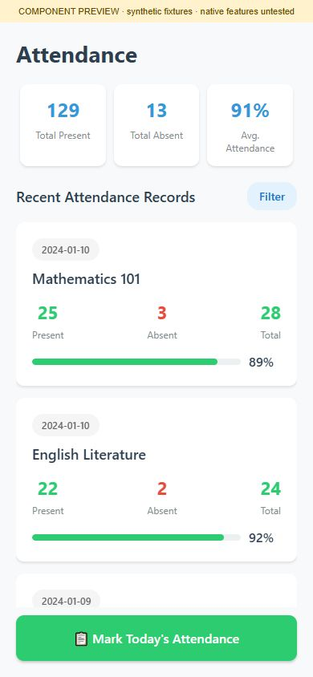

### Classes overview prototype

Displays the source’s built-in example timetable/class cards. Use class cards to explore class information in a configured app; preview cards do not prove backend class synchronization.

[Source component](https://github.com/asimasgharali243/school-management-system/blob/main/SchoolManagementApp/src/screens/Classes/ClassesScreen.js)

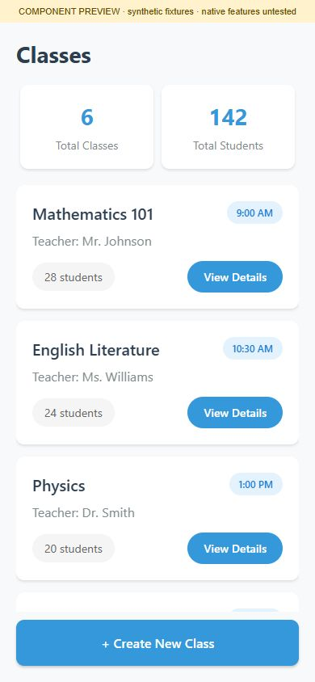

### Default dashboard prototype

Presents the source’s generic dashboard shortcuts and sample counters. It is distinct from the teacher-specific dashboard.

[Source component](https://github.com/asimasgharali243/school-management-system/blob/main/SchoolManagementApp/src/screens/Default/DashboardScreen.js)

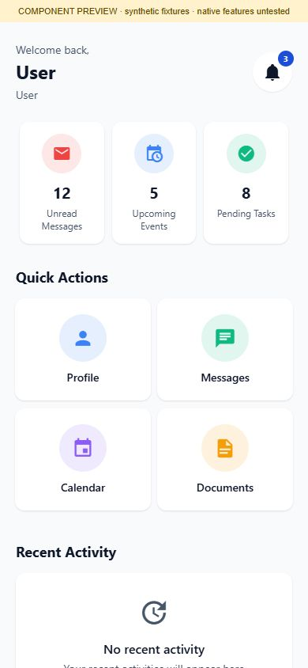

### Password recovery placeholder

Provides the supplied recovery entry screen and a return-to-login button. Recovery delivery is not implemented or tested by this capture.

[Source component](https://github.com/asimasgharali243/school-management-system/blob/main/SchoolManagementApp/src/screens/ForgotPasswordScreen.js)

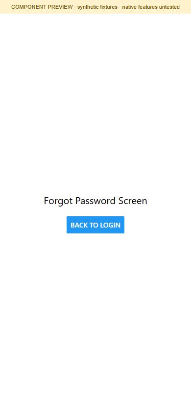

### Home overview

Provides school overview cards and student-related entry points. Some counters in the source are illustrative; this preview does not verify school statistics.

[Source component](https://github.com/asimasgharali243/school-management-system/blob/main/SchoolManagementApp/src/screens/Home/HomeScreen.js)

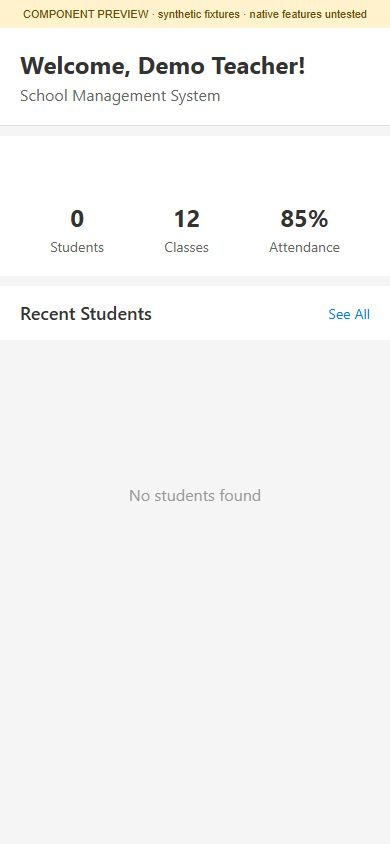

### Loading state

Displays the application’s transitional loading indicator. This is intentionally a loading screen, not a completed data page.

[Source component](https://github.com/asimasgharali243/school-management-system/blob/main/SchoolManagementApp/src/screens/LoadingScreen.js)

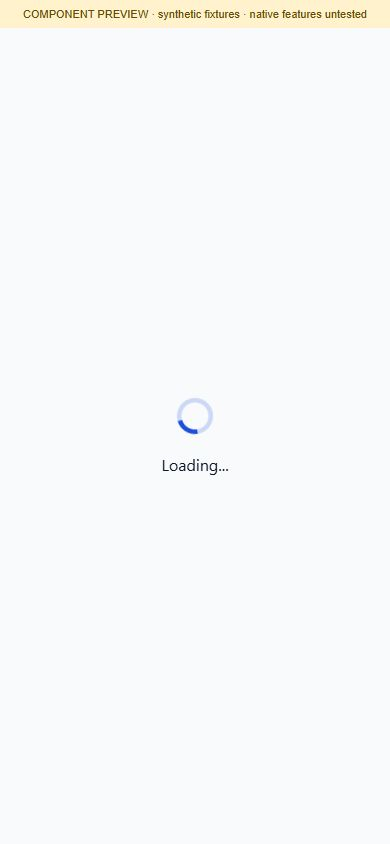

### Mobile sign in

Enter a configured username/password and use Login; Forgot Password opens the recovery entry. Login persistence and native authentication are not tested in this component preview.

[Source component](https://github.com/asimasgharali243/school-management-system/blob/main/SchoolManagementApp/src/screens/LoginScreen.js)

### Notification details

Read a selected notice and find the acknowledgement control. The displayed notice is synthetic; acknowledgement and native push delivery were not executed.

[Source component](https://github.com/asimasgharali243/school-management-system/blob/main/SchoolManagementApp/src/screens/Notifications/NotificationDetailScreen.js)

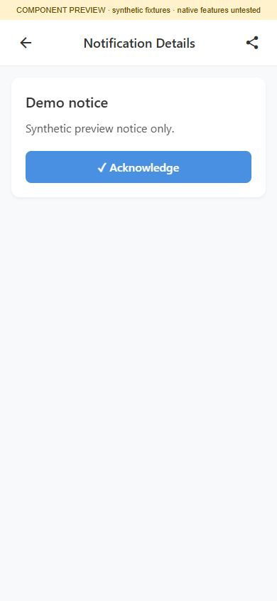

### Notification inbox

Review notices and pull to refresh. The empty state here uses synthetic preview data, not a checked production inbox.

[Source component](https://github.com/asimasgharali243/school-management-system/blob/main/SchoolManagementApp/src/screens/Notifications/NotificationsScreen.js)

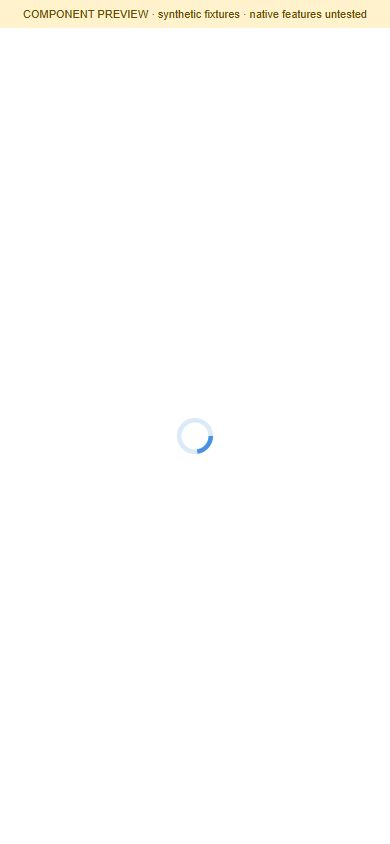

### Child attendance history

Lets a parent review attendance totals/history and date filters. The displayed empty-state percentages are not an actual student record.

[Source component](https://github.com/asimasgharali243/school-management-system/blob/main/SchoolManagementApp/src/screens/Parent/ChildAttendanceScreen.js)

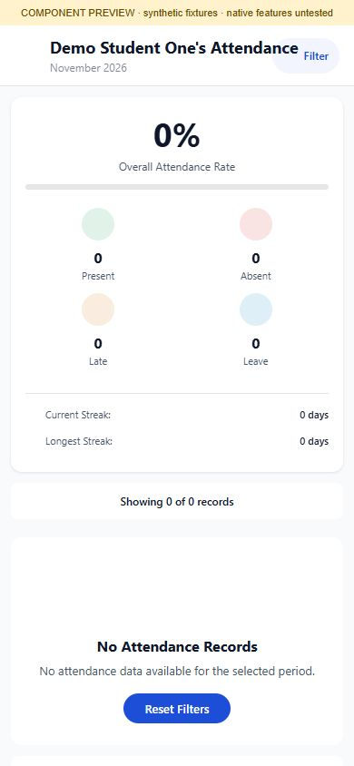

### Child dashboard

Provides attendance, grades, diary and other child-specific entry points. The selected child is synthetic and query results use empty preview states.

[Source component](https://github.com/asimasgharali243/school-management-system/blob/main/SchoolManagementApp/src/screens/Parent/ChildDashboardScreen.js)

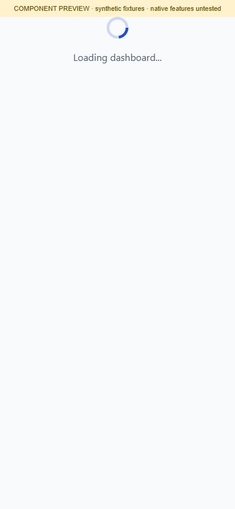

### Child details prototype

Displays the overview portion of the child detail component. The source contains hardcoded sample identity fields and placeholder tabs; native tab navigation is not tested.

[Source component](https://github.com/asimasgharali243/school-management-system/blob/main/SchoolManagementApp/src/screens/Parent/ChildDetailsScreen.js)

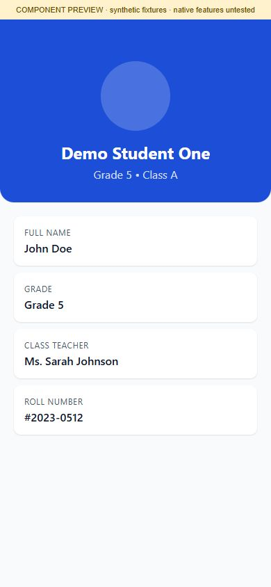

### Child diary

Supports date navigation, subject/teacher search and diary viewing. The empty state does not verify diary synchronization, PDF export or sharing.

[Source component](https://github.com/asimasgharali243/school-management-system/blob/main/SchoolManagementApp/src/screens/Parent/ChildDiaryScreen.js)

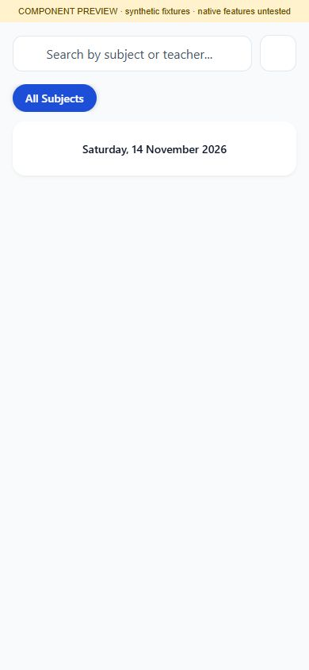

### Child grades

Provides grade history and summary entry points for the selected child. No grade records are supplied in this preview.

[Source component](https://github.com/asimasgharali243/school-management-system/blob/main/SchoolManagementApp/src/screens/Parent/ChildGradesScreen.js)

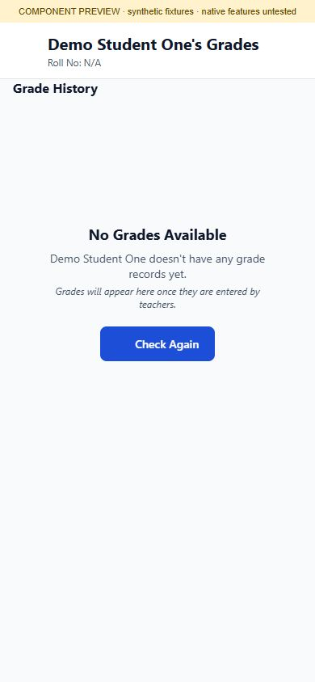

### Parent children list

Lists children linked to a parent account and opens each child’s dashboard. The preview shows the no-children state; family matching is not verified.

[Source component](https://github.com/asimasgharali243/school-management-system/blob/main/SchoolManagementApp/src/screens/Parent/ChildrenListScreen.js)

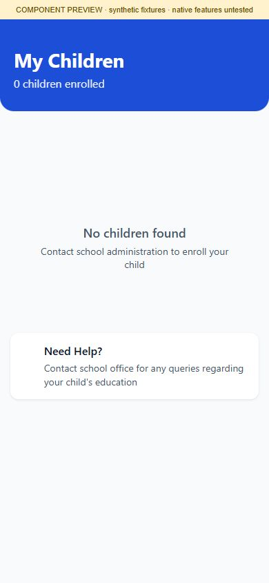

### Class diary and scheme of work

Switch between diary and scheme-of-work views and choose a date. Native date picking, PDF conversion and sharing remain untested.

[Source component](https://github.com/asimasgharali243/school-management-system/blob/main/SchoolManagementApp/src/screens/Parent/ClassDiaryAndSowScreen.js)

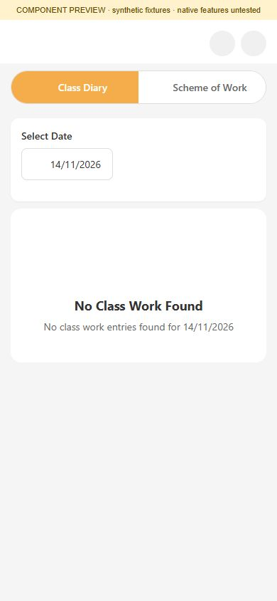

### Complaint details

Review a complaint’s status, priority, subject, details, student information and timeline. The displayed complaint is explicitly synthetic.

[Source component](https://github.com/asimasgharali243/school-management-system/blob/main/SchoolManagementApp/src/screens/Parent/ComplaintDetailScreen.js)

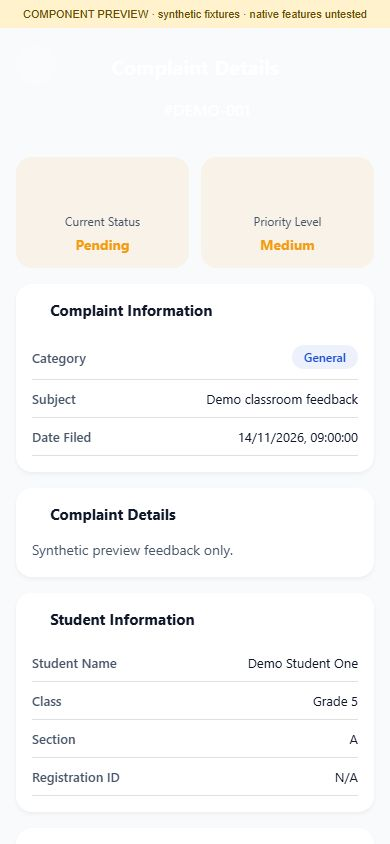

### Complaint list

Review a child’s complaints and open the create/detail screens. The screenshot shows the no-complaints state.

[Source component](https://github.com/asimasgharali243/school-management-system/blob/main/SchoolManagementApp/src/screens/Parent/ComplaintListScreen.js)

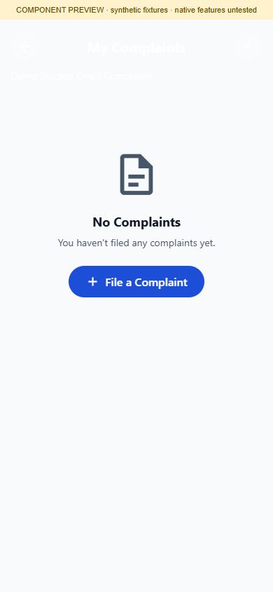

### Create complaint

Prepare a category, subject and detailed complaint for a selected child. This is a form preview only; no complaint was submitted.

[Source component](https://github.com/asimasgharali243/school-management-system/blob/main/SchoolManagementApp/src/screens/Parent/CreateComplaintScreen.js)

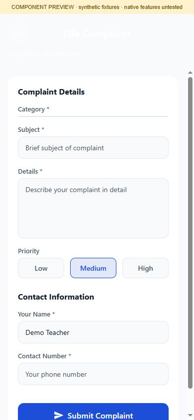

### Diary details

Shows a diary date, publication status, subject, teacher and HTML lesson content. A browser iframe adapter renders the synthetic HTML; this does not verify the native WebView.

[Source component](https://github.com/asimasgharali243/school-management-system/blob/main/SchoolManagementApp/src/screens/Parent/DiaryDetailScreen.js)

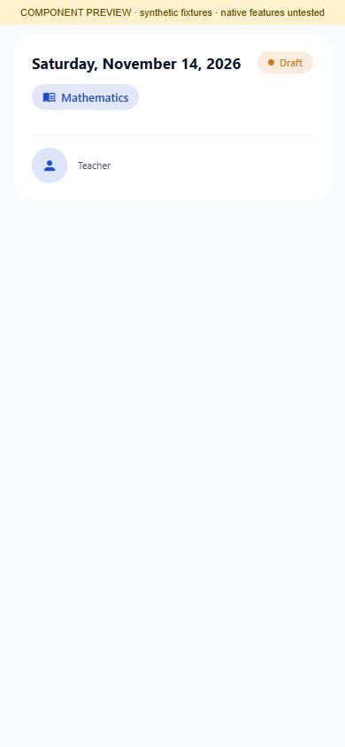

### Student fee ledger

Review fee-ledger balances, transaction details and export controls. The zero/empty fixture is not a verified financial statement; native PDF/share features were not invoked.

[Source component](https://github.com/asimasgharali243/school-management-system/blob/main/SchoolManagementApp/src/screens/Parent/StudentFeeLedgerScreen.js)

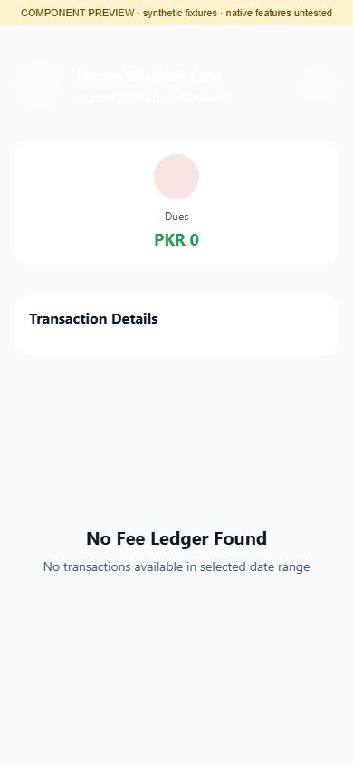

### Profile

Inspect personal details and profile preferences. The profile is a synthetic teacher; no profile update was submitted.

[Source component](https://github.com/asimasgharali243/school-management-system/blob/main/SchoolManagementApp/src/screens/Profile/ProfileScreen.js)

### Settings

Provides account, notification, appearance and other preference entry points. Native device settings, biometric options and password changes are not verified.

[Source component](https://github.com/asimasgharali243/school-management-system/blob/main/SchoolManagementApp/src/screens/Settings/SettingsScreen.js)

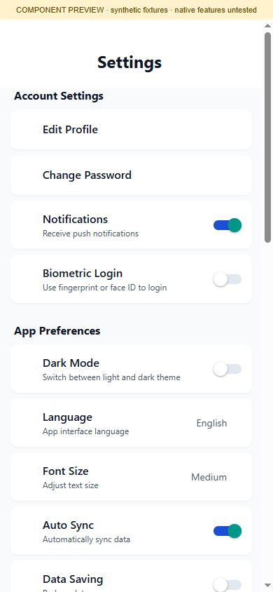

### Teacher attendance report

Choose a month and inspect attendance history for the class. The empty history does not establish backend report correctness.

[Source component](https://github.com/asimasgharali243/school-management-system/blob/main/SchoolManagementApp/src/screens/Teacher/AttendanceReportScreen.js)

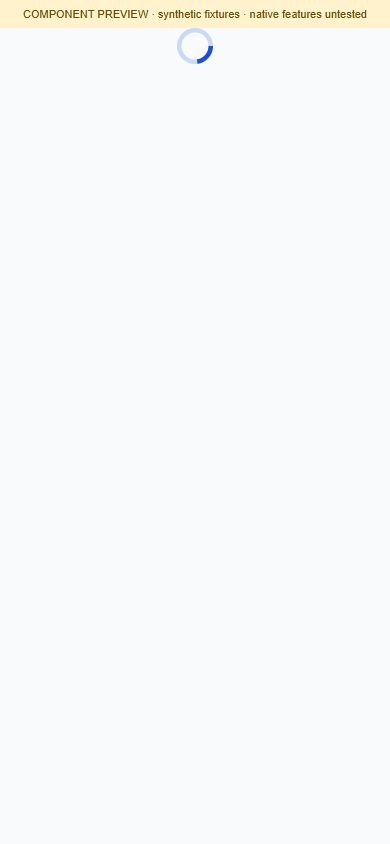

### Attendance management

Choose a class and enter attendance-related workflows. The assignment shown is a preview fixture, not a backend authorization test.

[Source component](https://github.com/asimasgharali243/school-management-system/blob/main/SchoolManagementApp/src/screens/Teacher/AttendanceScreen.js)

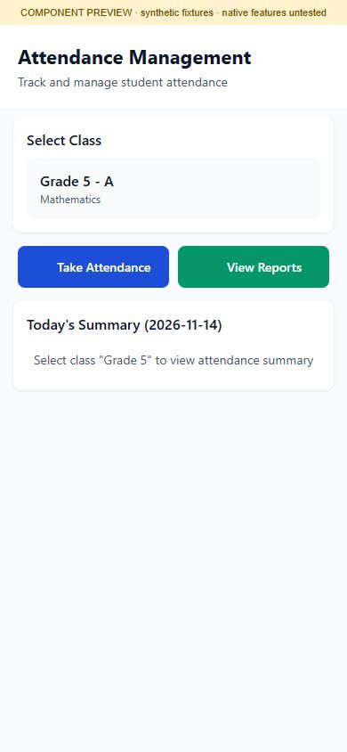

### Class student roster

Displays students for a chosen class/section. Two synthetic students demonstrate the roster layout; no real enrollment information is used.

[Source component](https://github.com/asimasgharali243/school-management-system/blob/main/SchoolManagementApp/src/screens/Teacher/ClassStudentsScreen.js)

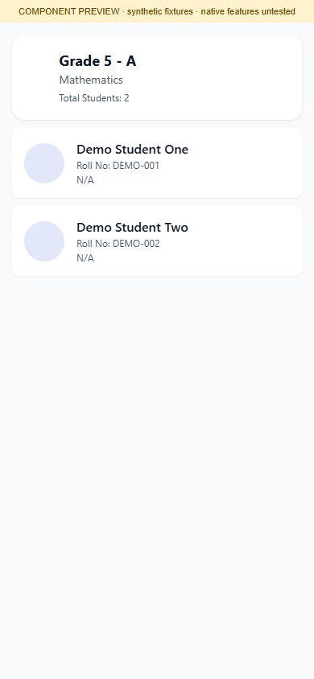

### Teacher classes

Lists the teacher’s assigned classes and sections. Select a class in a configured app to continue to students or attendance.

[Source component](https://github.com/asimasgharali243/school-management-system/blob/main/SchoolManagementApp/src/screens/Teacher/ClassesScreen.js)

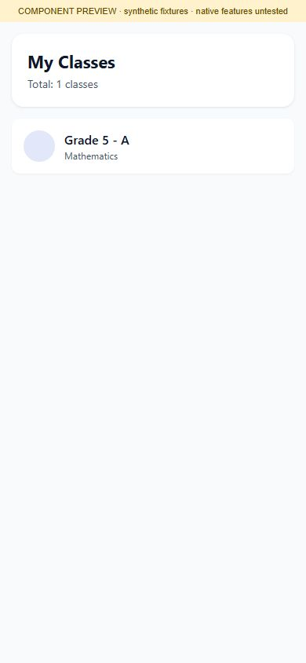

### Create diary

Prepare class/sections, subject and diary content. The browser preview substitutes a plain text input for the native rich editor; image capture, uploads, publication and native editor fidelity are not tested.

[Source component](https://github.com/asimasgharali243/school-management-system/blob/main/SchoolManagementApp/src/screens/Teacher/CreateDiaryScreen.js)

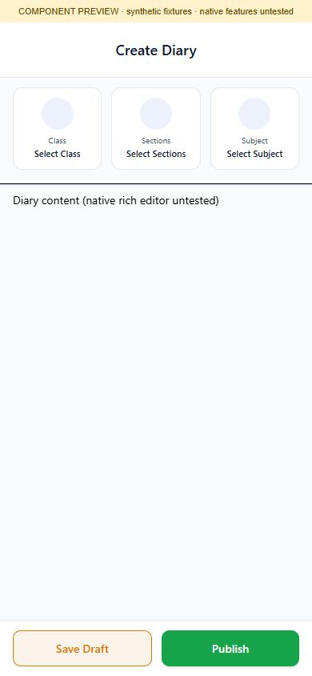

### Grades management prototype

Provides class/subject selection and grade entry controls. The source populates built-in mock grades after a delay; numbers here are illustrative.

[Source component](https://github.com/asimasgharali243/school-management-system/blob/main/SchoolManagementApp/src/screens/Teacher/GradesScreen.js)

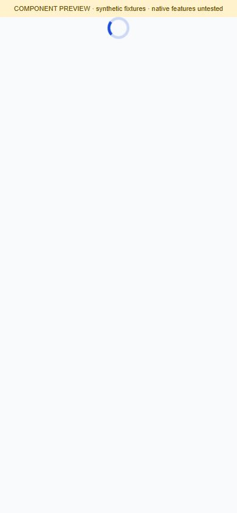

### Mark attendance

Review the roster and choose P (present), A (absent) or L (leave), with related remarks/late controls. Two synthetic students are shown; no attendance was submitted or persisted.

[Source component](https://github.com/asimasgharali243/school-management-system/blob/main/SchoolManagementApp/src/screens/Teacher/MarkAttendanceScreen.js)

### Student details prototype

Shows profile, grade/attendance summaries and quick actions. The component itself supplies mock family/contact/academic values; this is not live student information.

[Source component](https://github.com/asimasgharali243/school-management-system/blob/main/SchoolManagementApp/src/screens/Teacher/StudentDetailsScreen.js)

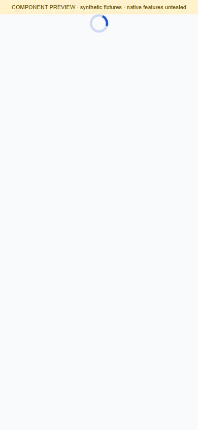

### Teacher dashboard

Shows assigned classes/subjects and shortcuts to classroom workflows. One synthetic Grade 5 A Mathematics assignment is supplied by the preview fixture.

[Source component](https://github.com/asimasgharali243/school-management-system/blob/main/SchoolManagementApp/src/screens/Teacher/TeacherDashboard.js)

### Teacher diary list

Review diary entries and filter the list; the preview shows no entries. Backend load/filter persistence is not verified.

[Source component](https://github.com/asimasgharali243/school-management-system/blob/main/SchoolManagementApp/src/screens/Teacher/TeacherDiaryListScreen.js)

## Source coverage limits

The index covers source files containing an active default-exported screen component, excluding helper components. It is a source-component inventory, not a claim that every listed prototype is reachable in the app navigators. `Parent/AllGradesScreen.js` and `Students/StudentsScreen.js` do not provide an active exported screen in the reviewed source and have no invented screenshot. OS permission prompts, hardware interactions, native file dialogs and all error/confirmation states are outside this gallery.
