# Mobile gallery by role

This replaces the earlier source-component inventory with **only screen components registered in the Admin, Teacher and Parent navigators**. Unused Default/Home/Classes/Attendance prototypes are excluded. Shared aliases and navigator containers are not counted twice.

**Capture limits:** these are role-specific React Native Web UI previews at phone size, not native Android/iOS captures. The preview imports the exact published role resolver, restricts screen selection to each navigator’s registered components, and supplies separate synthetic Admin/Teacher/Parent identities. Native navigation containers, query/storage/notification modules and native widgets are adapted. Actual root navigator selection and auth thunk/reducer behavior were separately checked with React test rendering and mocked API/storage—not with a live school server.

## Role selection

| Account | Landing screen |
|---|---|
| Admin / Administrator / Super Admin role name | AdminDashboard |
| Teacher role name or API role ID 3, including string IDs | TeacherDashboard |
| Parent role name or API role ID 4, including string IDs | ChildrenList |
| Missing, unsupported or conflicting role | Access not configured, with Refresh account and Sign out |

Unrecognized numeric administrative IDs are not guessed. The API response must identify an administrative role by name. Frontend routing does not replace server authorization.

## Shared sign in

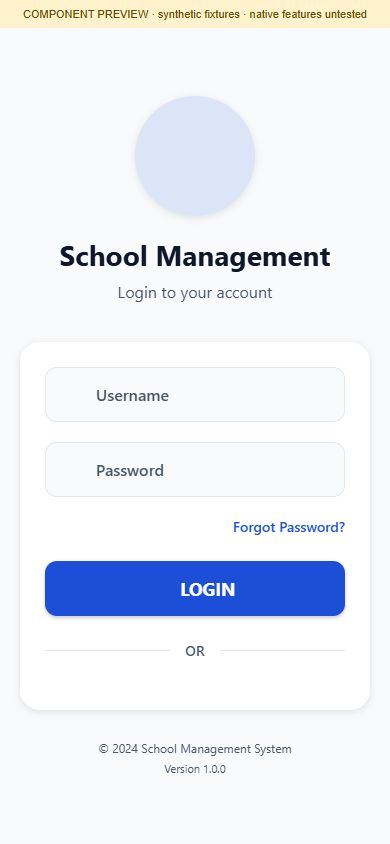

## Admin — 5 registered screen views

A dedicated Admin navigator/landing screen was added because the original app had no Admin navigator. It supports the existing shared notification/profile/settings areas; it does not invent completed mobile administrative editors.

### Admin: AdminDashboard

Administrator landing area with account notifications, profile and settings. The supplied app has no mobile school-record editors; use the configured web portal for those workflows.

**Component:** `Admin/AdminDashboardScreen.js`

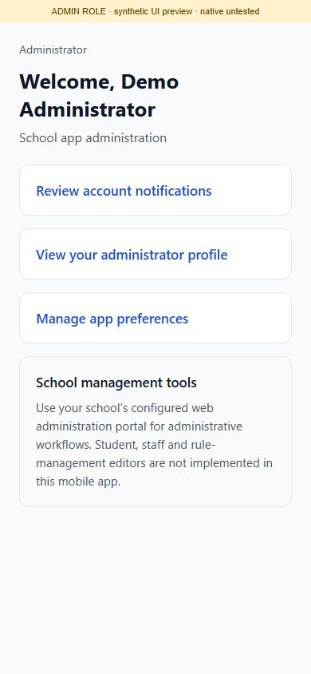

### Admin: Notifications

Review notices for the signed-in account. The empty inbox uses synthetic preview state; delivery and read-state persistence are not verified.

**Component:** `Notifications/NotificationsScreen.js`

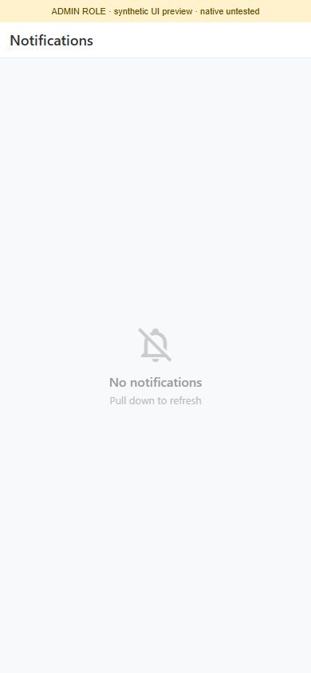

### Admin: NotificationDetail

Read the selected synthetic notice and view the acknowledgement control. No acknowledgement request was submitted.

**Component:** `Notifications/NotificationDetailScreen.js`

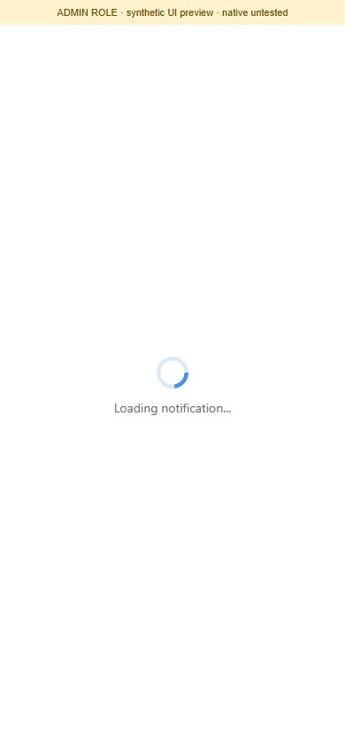

### Admin: AdminProfile

View the administrator account profile. The displayed account is synthetic; profile updates were not submitted.

**Component:** `Profile/ProfileScreen.js`

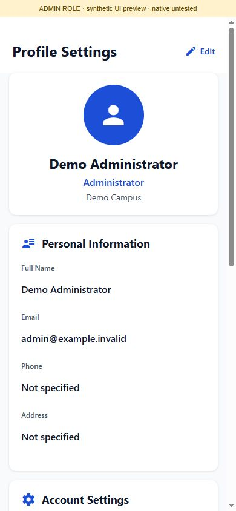

### Admin: AdminSettings

View app/account preferences as an administrator. Unimplemented actions now report that they are unavailable instead of navigating to nonexistent screens.

**Component:** `Settings/SettingsScreen.js`

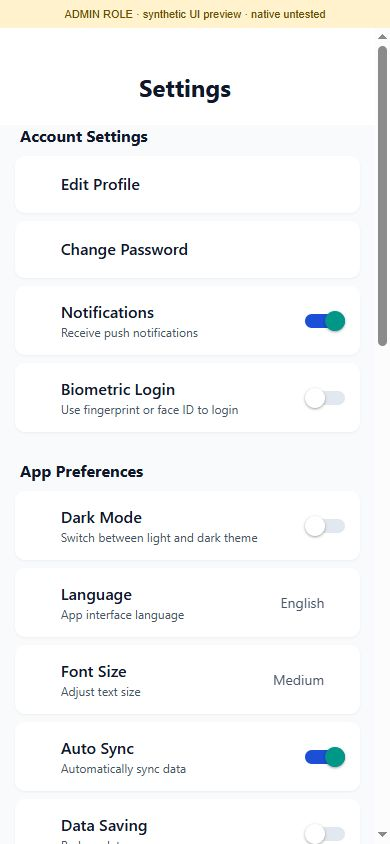

## Teacher — 14 registered screen views

### Teacher: TeacherDashboard

Teacher landing screen with the teacher’s synthetic class/subject assignment and classroom shortcuts.

**Component:** `Teacher/TeacherDashboard.js`

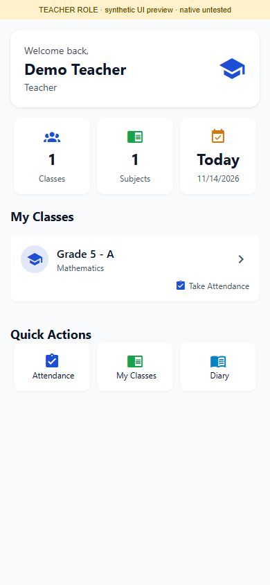

### Teacher: TeacherClasses

Review the teacher’s assigned classes and sections; select a class to continue to its roster.

**Component:** `Teacher/ClassesScreen.js`

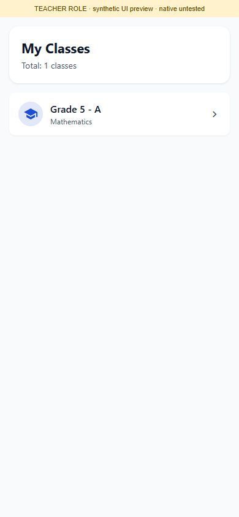

### Teacher: TeacherAttendance

Choose a class and enter the attendance workflow. This is a synthetic UI preview, not a saved attendance transaction.

**Component:** `Teacher/AttendanceScreen.js`

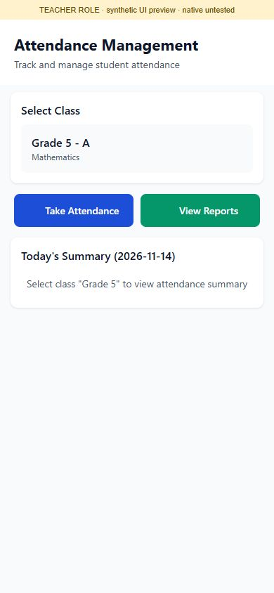

### Teacher: TeacherProfile

View the teacher account profile. The screenshot uses a Teacher account, not an unassigned/default account.

**Component:** `Profile/ProfileScreen.js`

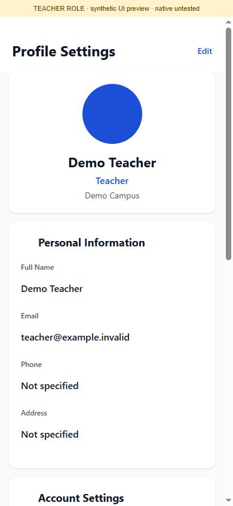

### Teacher: Notifications

Review notices for the signed-in account. The empty inbox uses synthetic preview state; delivery and read-state persistence are not verified.

**Component:** `Notifications/NotificationsScreen.js`

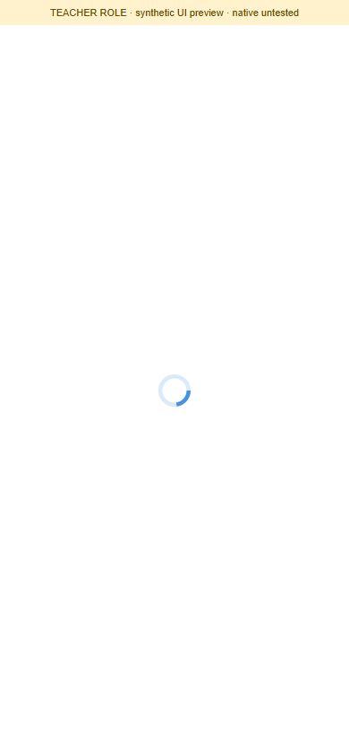

### Teacher: TeacherSettings

View teacher app preferences. Missing feature routes now show an explicit availability message.

**Component:** `Settings/SettingsScreen.js`

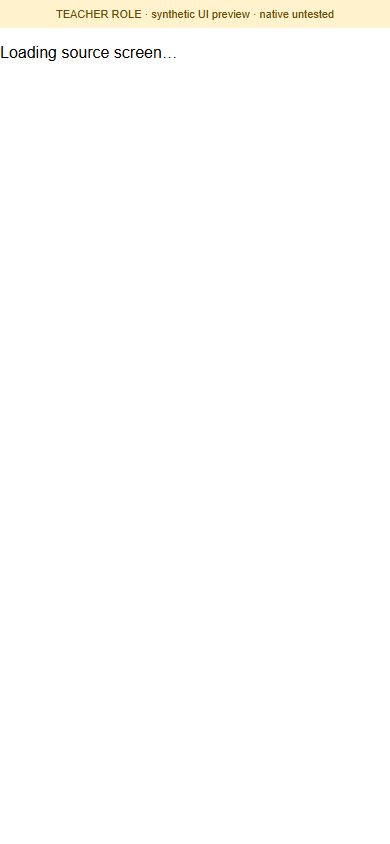

### Teacher: NotificationDetail

Read the selected synthetic notice and view the acknowledgement control. No acknowledgement request was submitted.

**Component:** `Notifications/NotificationDetailScreen.js`

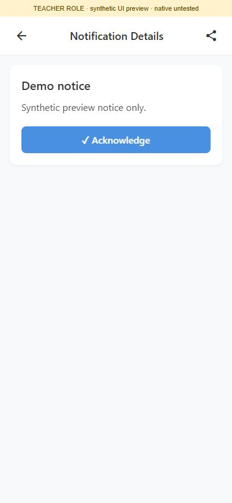

### Teacher: ClassStudents

Review two synthetic students in Grade 5 A. Student data is not from a real school database.

**Component:** `Teacher/ClassStudentsScreen.js`

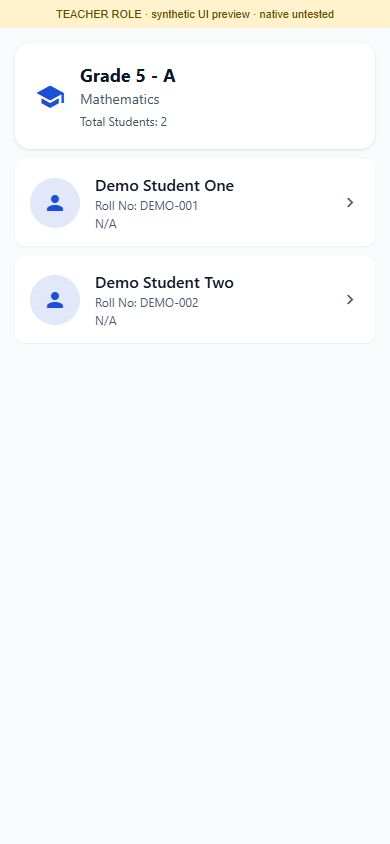

### Teacher: StudentDetails

Inspect the student detail layout and quick actions. This component still contains source-defined mock academic/contact data; it is not a live student report.

**Component:** `Teacher/StudentDetailsScreen.js`

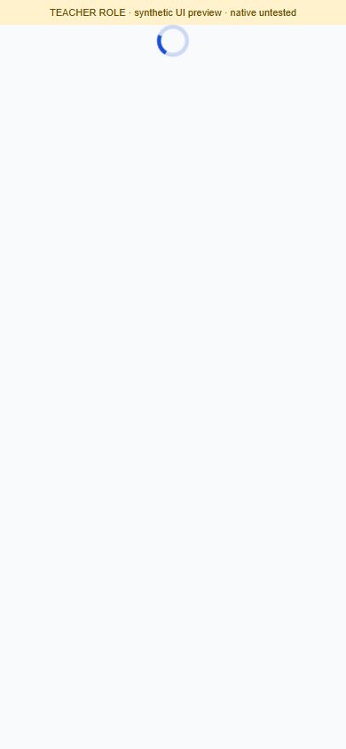

### Teacher: MarkAttendance

Choose P, A or L for a roster entry and access remarks/late controls. No attendance was saved; this screenshot does not prove backend persistence.

**Component:** `Teacher/MarkAttendanceScreen.js`

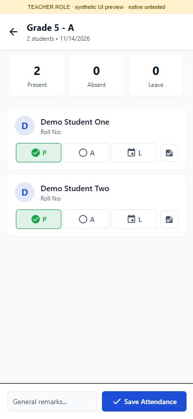

### Teacher: AttendanceReport

Inspect class/month attendance report controls. The preview does not supply a measured attendance history.

**Component:** `Teacher/AttendanceReportScreen.js`

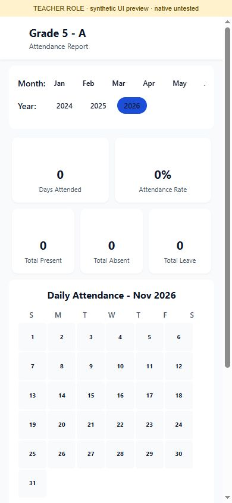

### Teacher: Grades

Inspect grade-entry controls. The original component still uses built-in mock grades; grade persistence has not been implemented or verified by this change.

**Component:** `Teacher/GradesScreen.js`

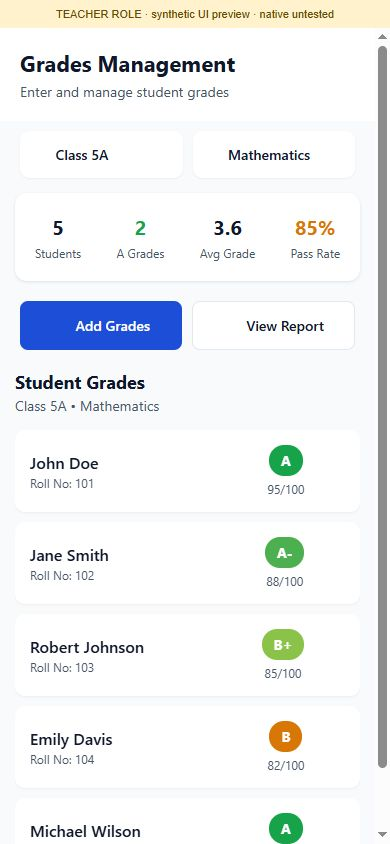

### Teacher: TeacherDiaryList

Inspect the teacher’s diary list and filter controls. The screenshot shows an empty fixture list.

**Component:** `Teacher/TeacherDiaryListScreen.js`

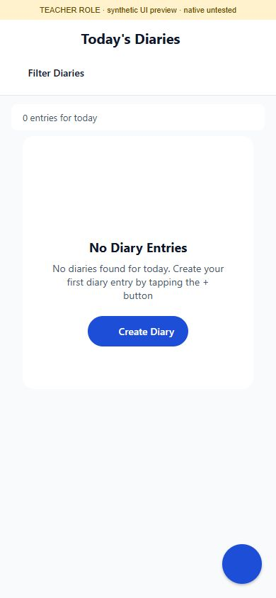

### Teacher: CreateDiary

Prepare class/sections, subject and diary content. Native rich editing, camera/upload and publication are unverified; the browser uses a text-input adapter for the native editor.

**Component:** `Teacher/CreateDiaryScreen.js`

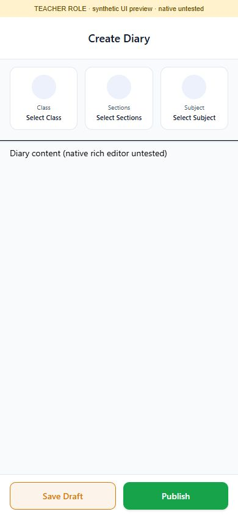

## Parent — 15 registered screen views

### Parent: ChildDashboard

Review the selected child’s dashboard and workflow entry points. Unsupported Homework/Reports destinations now show an availability message rather than dispatching a missing route.

**Component:** `Parent/ChildDashboardScreen.js`

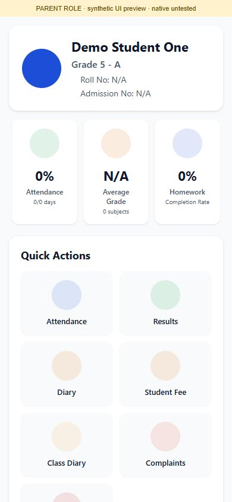

### Parent: ChildAttendance

Inspect a child’s attendance totals/history and filters in an empty fixture state.

**Component:** `Parent/ChildAttendanceScreen.js`

### Parent: ChildGrades

Inspect child grade history and filters. The missing GradeReportDetail destination now produces an availability message; PDF generation remains unverified.

**Component:** `Parent/ChildGradesScreen.js`

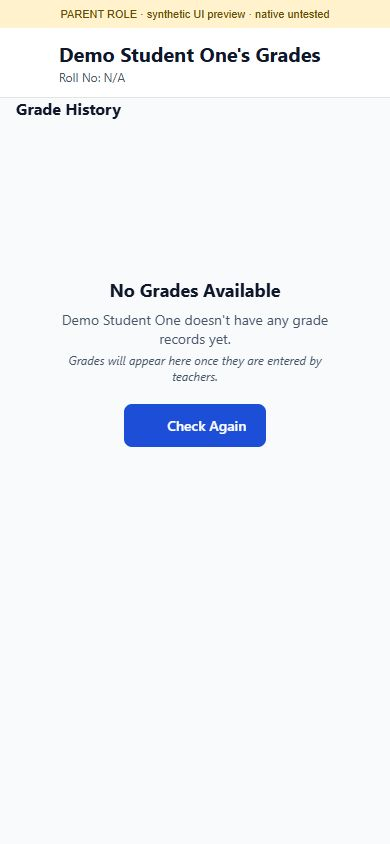

### Parent: ChildDiary

Inspect diary date navigation and subject/teacher search. The query state is empty; no school diary was fetched.

**Component:** `Parent/ChildDiaryScreen.js`

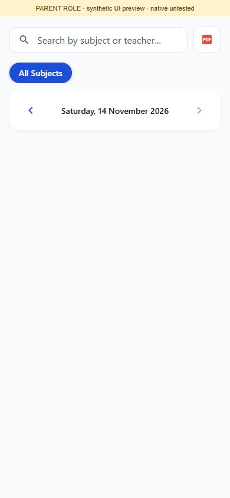

### Parent: DiaryDetail

Read a synthetic diary entry. Browser HTML rendering substitutes for the native WebView and does not establish native parity.

**Component:** `Parent/DiaryDetailScreen.js`

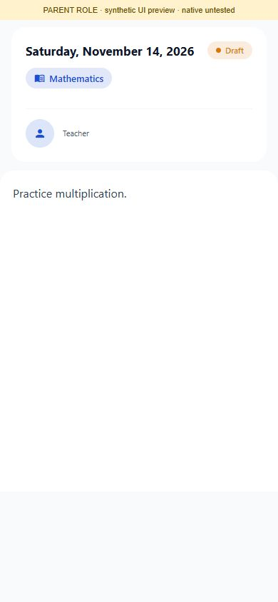

### Parent: StudentFeeLedger

Inspect the child’s fee-ledger layout. Zero/empty fixtures are not verified financial records; no export or financial transaction occurred.

**Component:** `Parent/StudentFeeLedgerScreen.js`

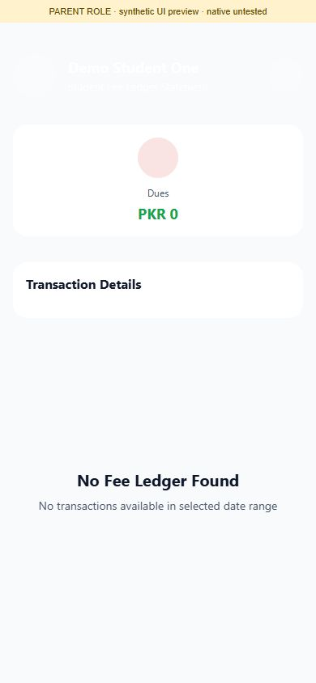

### Parent: ChildrenList

Parent landing screen listing two synthetic linked children. Each child card exposes the child-specific workflows; live family/account linking is not tested.

**Component:** `Parent/ChildrenListScreen.js`

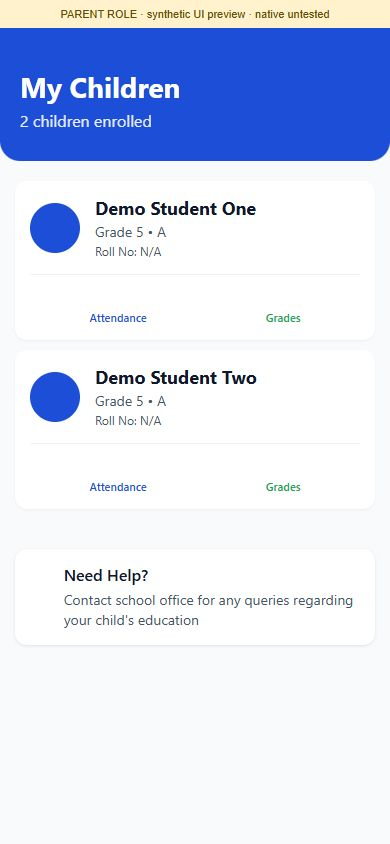

### Parent: Profile

Inspect the parent account’s profile. The screenshot now uses a Parent identity. Logout clears persisted local session keys and returns through the root authentication switch.

**Component:** `Profile/ProfileScreen.js`

### Parent: Settings

Inspect parent preferences. Unsupported features report their availability explicitly.

**Component:** `Settings/SettingsScreen.js`

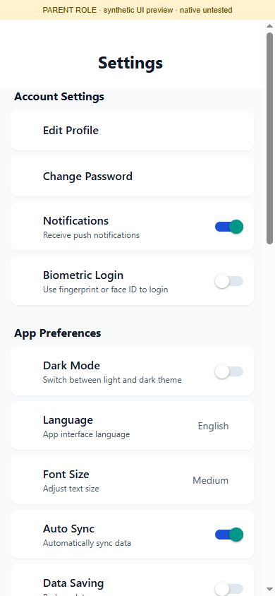

### Parent: Notifications

Review notices for the signed-in account. The empty inbox uses synthetic preview state; delivery and read-state persistence are not verified.

**Component:** `Notifications/NotificationsScreen.js`

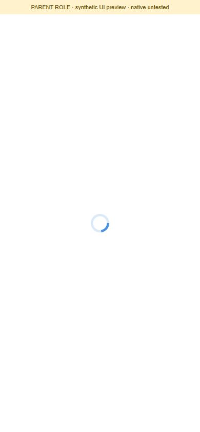

### Parent: NotificationDetail

Read the selected synthetic notice and view the acknowledgement control. No acknowledgement request was submitted.

**Component:** `Notifications/NotificationDetailScreen.js`

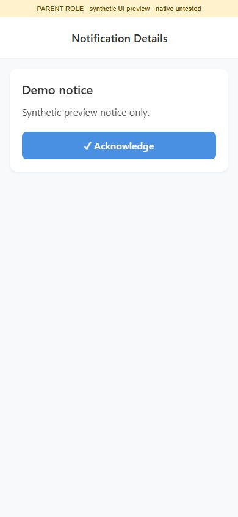

### Parent: ClassDiaryAndSow

Review class diary/scheme-of-work tabs and date controls. Native date picking, PDF/share and backend loading remain unverified.

**Component:** `Parent/ClassDiaryAndSowScreen.js`

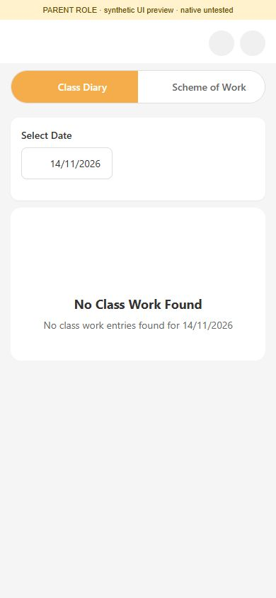

### Parent: ComplaintList

Inspect the child’s complaint list in its empty state.

**Component:** `Parent/ComplaintListScreen.js`

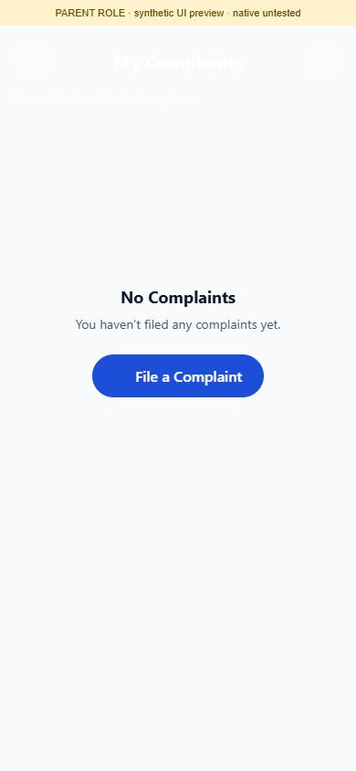

### Parent: CreateComplaint

Prepare a complaint category, subject and details for the selected child. No complaint was submitted.

**Component:** `Parent/CreateComplaintScreen.js`

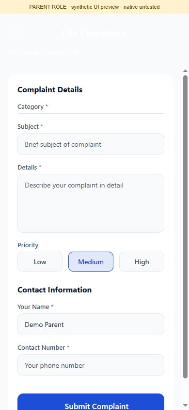

### Parent: ComplaintDetail

Inspect a synthetic complaint’s status, priority, student details and timeline.

**Component:** `Parent/ComplaintDetailScreen.js`

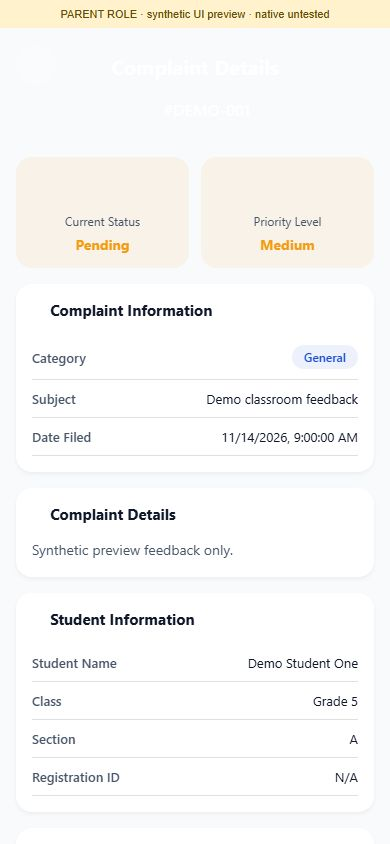

## Missing or unsupported role

The generic Default dashboard is no longer selected for these accounts. Refresh account reloads the server’s role metadata; Sign out clears the local session. Unknown roles are not promoted to Admin, Parent or Teacher.

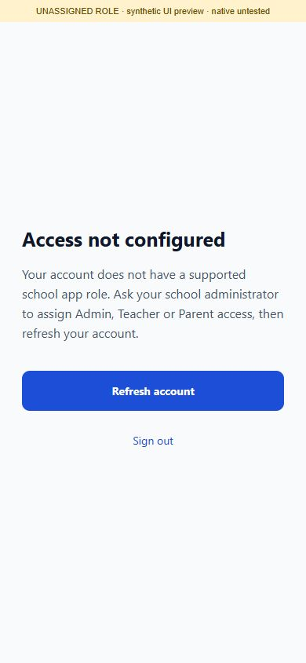

## Checks and remaining limits

See [role-routing validation](ROLE_VALIDATION.md). No live school account, real student record, backend write, Firebase/Expo delivery, native build or device feature is certified by these screenshots. Source mock grades/student details and incomplete mobile features remain explicitly identified above.
