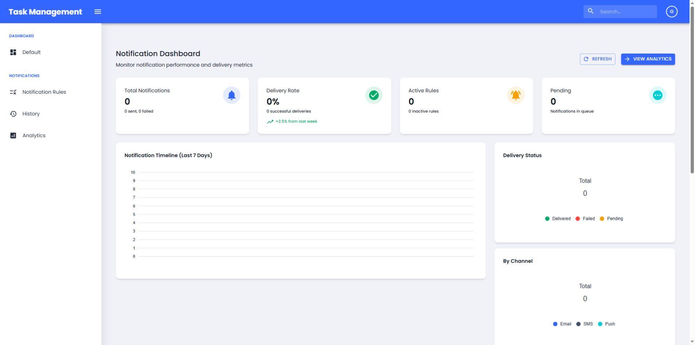
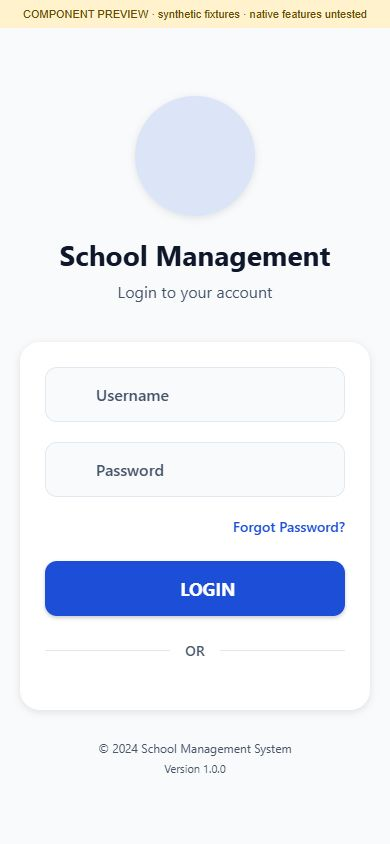
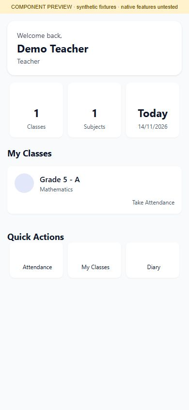
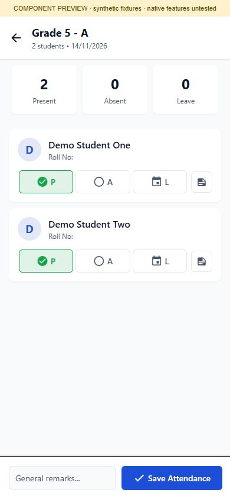

# School Management System · screenshot galleries

- **[Web portal gallery](WEB_GALLERY.md): 13 views** covering sign in, registration, notification dashboard, rules, the five-step rule wizard, archived history, analytics and current placeholder routes.
- **[School app component gallery](MOBILE_GALLERY.md): 33 phone-size previews** covering teacher, parent, diary, attendance, grades, complaints, fee, profile, settings and notification screen components.

The web views use an isolated local fixture API. The mobile images are React Native Web component previews with synthetic data and native-module adapters, **not native Android/iOS screenshots**. Mobile images carry a component-preview banner; the detailed galleries describe the capture method and fixture data for both clients. No live school records, notifications or transactions were used. This gallery does not establish working backend persistence, production authentication or native device features.

## Web preview

## School app previews

  

## Existing source gaps

The supplied web portal retains Task Management branding. Templates and Settings are hello-world placeholders; the web User Management implementation is commented out and its route cannot render. Several mobile components contain built-in mock values or placeholders. These are documented in the detailed galleries rather than represented as completed features.
