# Web portal gallery

13 captured web views, including the five rule-creation steps. [Mobile app component gallery](MOBILE_GALLERY.md) · [Gallery overview](SCREEN_GUIDE.md).

## Capture method and scope

These are screenshots of the actual React/Vite source running locally. An isolated loopback fixture service supplied synthetic authentication and empty API response data. The displayed zero/empty values are preview fixtures, not production metrics. No deployed school service, production database, real student information, notification delivery or account creation was used or verified. Preview fixture code was not added to the application.

The web source in this repository currently provides a notification-focused administration portal, with Task Management branding. It does not contain a completed browser page for every school module present in the mobile app or backend.

## Screens

### Sign in

**Purpose and use:** Enter the configured account credentials to enter the web portal.

**Route:** `/application/login`

**Status:** The capture uses an isolated fixture login response; it does not verify the ASP.NET authentication service.

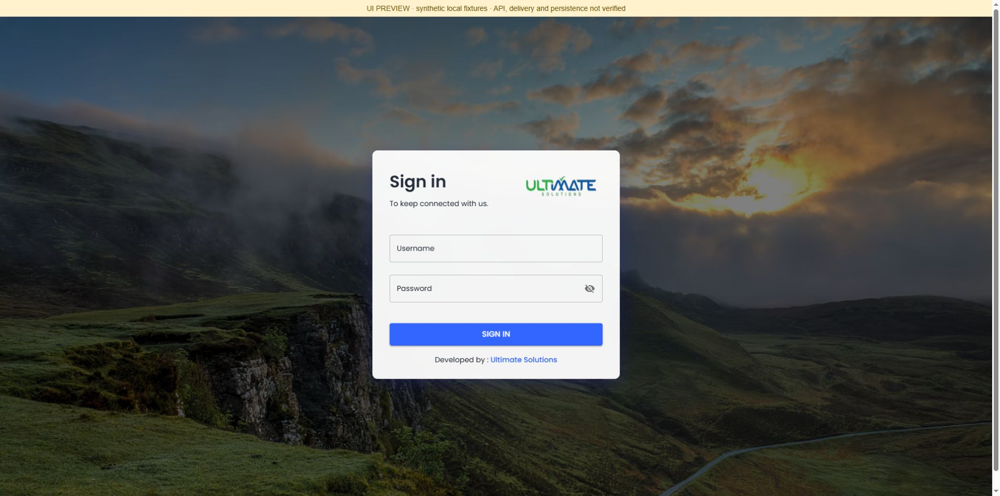

### Register

**Purpose and use:** Enter a full name, username and password to prepare account registration.

**Route:** `/application/register`

**Status:** The blank form was captured only. No account was created or terms accepted.

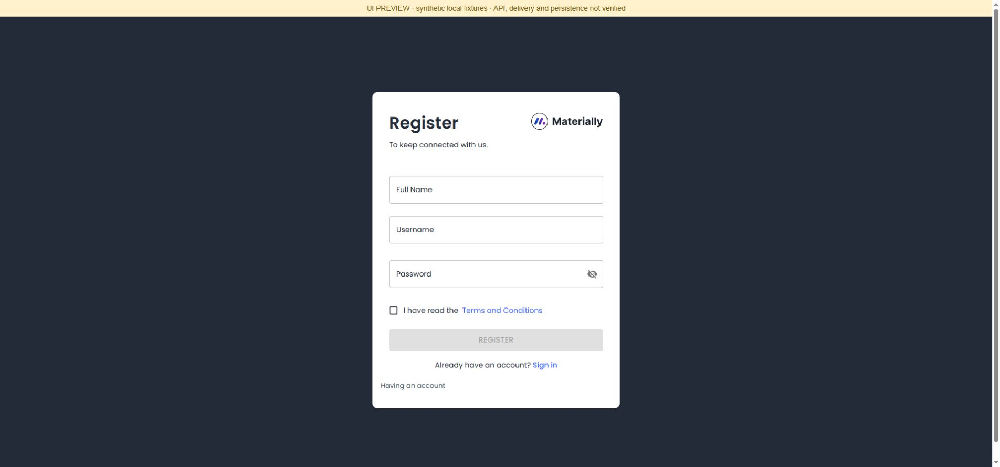

### Notification dashboard

**Purpose and use:** Review notification counts, delivery charts, active rules, recent notices and quick actions.

**Route:** `/dashboard/default`

**Status:** The supplied portal retains Task Management branding. Zero values come from the local preview fixture. Service Active labels and trend text are UI content, not verified delivery/health checks.

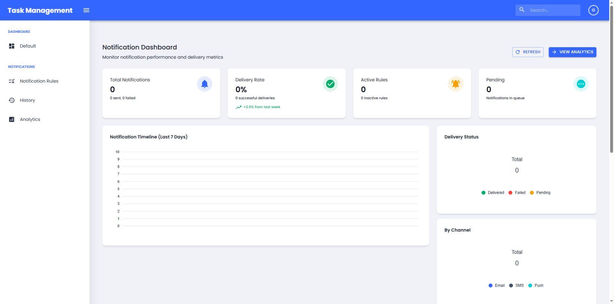

### Notification rules

**Purpose and use:** Search and filter automated rules by status, type or category; start a new rule.

**Route:** `/dashboard/notification-rules`

**Status:** Captured in the empty-list state. Rule execution, deletion and persistence were not tested.

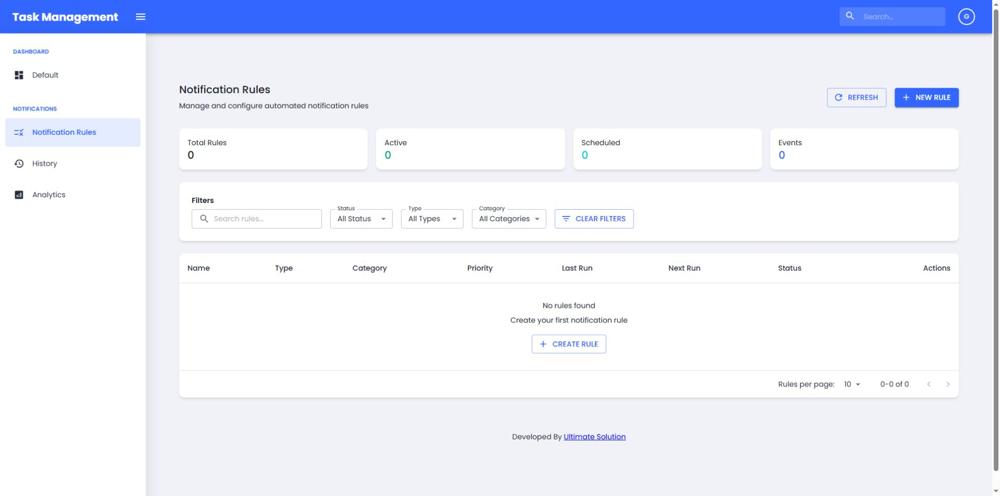

### Rule wizard: basic information

**Purpose and use:** Enter a descriptive rule name, type, category and active status.

**Route:** `/dashboard/notification-rules/create`

**Status:** Navigation through the five wizard steps was inspected; no rule was submitted.

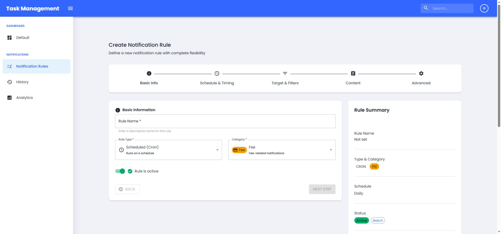

### Rule wizard: schedule

**Purpose and use:** Choose when a scheduled rule should run.

**Route:** `/dashboard/notification-rules/create`

**Status:** The Daily timing screen was captured. No scheduler was started.

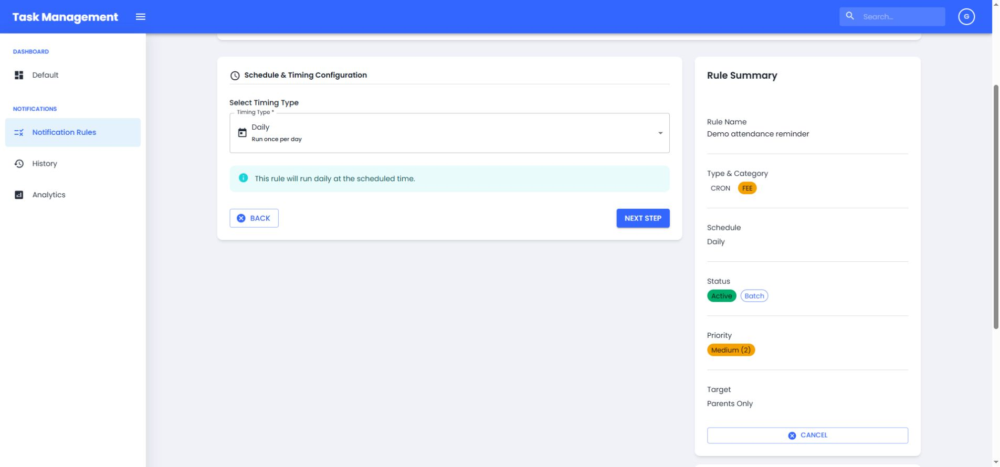

### Rule wizard: recipients

**Purpose and use:** Choose recipients and category-specific filters, including parent targeting and batch delivery.

**Route:** `/dashboard/notification-rules/create`

**Status:** Family matching and recipient selection require real backend validation.

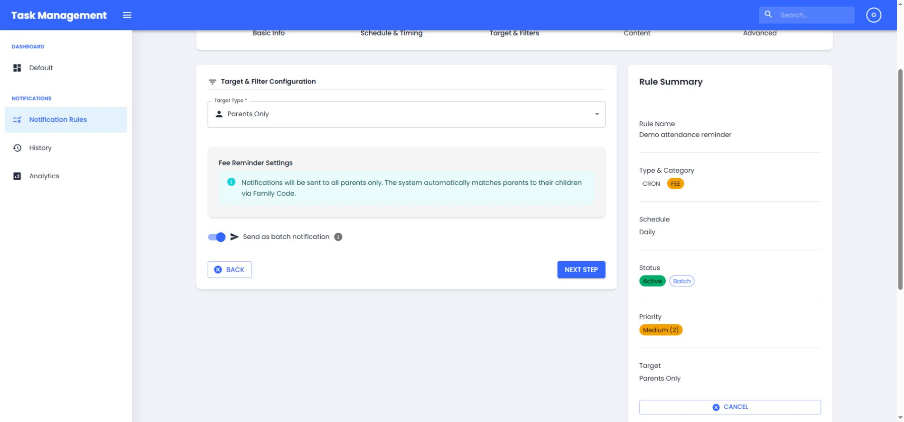

### Rule wizard: message content

**Purpose and use:** Compose title/body templates, insert variables and inspect the live message preview.

**Route:** `/dashboard/notification-rules/create`

**Status:** Synthetic content was typed into the actual rich-text controls. No notification was sent.

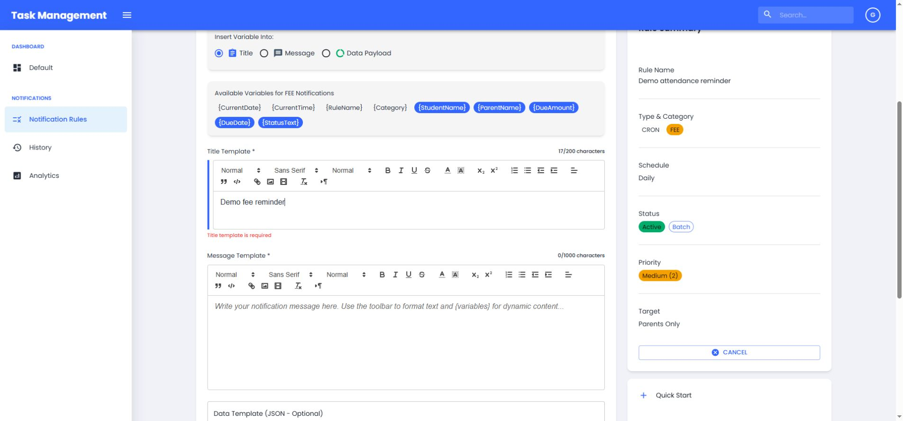

### Rule wizard: advanced options

**Purpose and use:** Review priority, creator, final target and rule summary before creating the rule.

**Route:** `/dashboard/notification-rules/create`

**Status:** Captured before submission; Create Rule was not invoked.

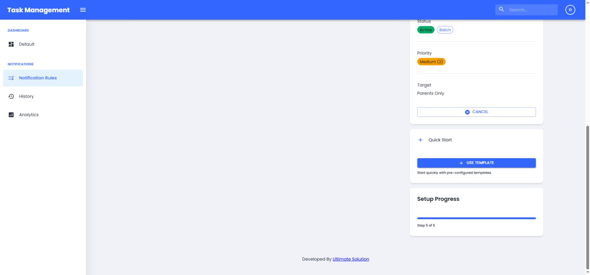

### Archived notification history

**Purpose and use:** Search archived notices by title, message, user, category or archive date.

**Route:** `/dashboard/notification-history`

**Status:** The preview contains no delivered or archived student notifications.

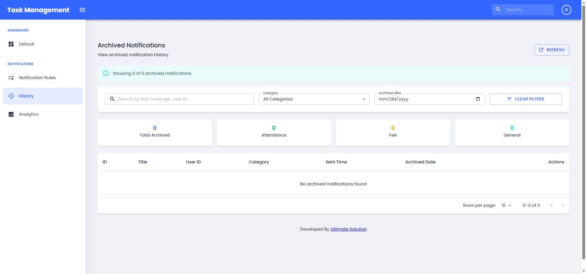

### Notification analytics

**Purpose and use:** Inspect time-range charts, status/category summaries and device/system totals.

**Route:** `/dashboard/notification-analytics`

**Status:** This source screen includes its own simulated fallback chart data and displays Simulated labels. These are not measured school delivery metrics.

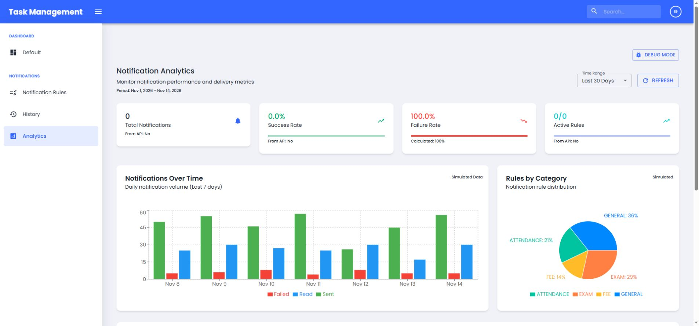

### Templates placeholder

**Purpose and use:** Reserved route for notification templates.

**Route:** `/dashboard/notification-templates`

**Status:** The current source renders hello world. This screenshot records the existing placeholder, not a completed template manager.

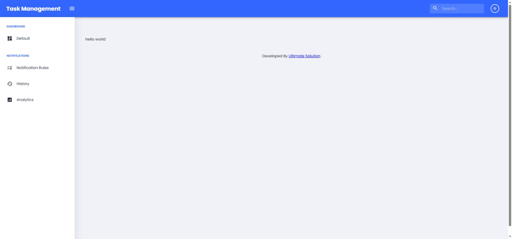

### Settings placeholder

**Purpose and use:** Reserved route for notification settings.

**Route:** `/dashboard/notification-settings`

**Status:** The current source renders hello world. This screenshot records the existing placeholder, not a completed settings workflow.

## Routes that cannot be presented as complete

- `/dashboard/user-management`: the referenced `UserManagement/index.jsx` implementation, including its default export, is entirely commented out. Opening the route causes the lazy component to fail. No blank/error screenshot is published as a working user-management page.
- `/dashboard/notification-rules/:id`: edit mode shares the rule wizard, but loading and updating an existing saved rule were not verified.
- Templates and Settings are documented placeholders above.
- Backend authentication, SQL persistence, Hangfire execution, Firebase/Expo delivery, email/SMS delivery, permission enforcement and deployment remain outside this gallery validation.
